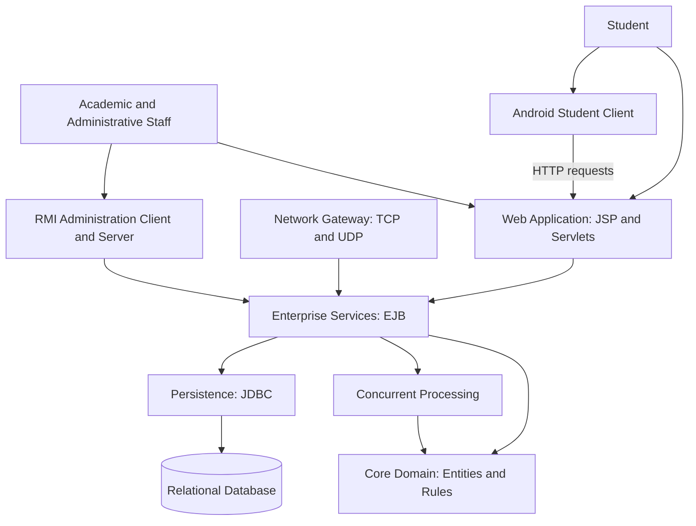

# SCASP — Component Architecture Design

## 1. Introduction

The Smart Campus Academic Services Platform (SCASP) follows a modular, multi-tier architecture.

The system separates user interfaces, business logic, networking, concurrent processing, and database operations into different components.

This separation improves maintainability, testing, scalability, and teamwork.

## 2. Architectural Layers

### 2.1 Presentation Layer

The presentation layer allows users to interact with the system.

Components:

- Web application using JSP, HTML, CSS, and Servlets.
- Android student application.

Responsibilities:

- Display course information.
- Provide login and registration forms.
- Display academic service requests.
- Present announcements and reports.
- Communicate with backend services.

### 2.2 Business Logic Layer

The business logic layer processes academic operations and applies system rules.

Components:

- Core Domain Module
- Enterprise Services Module
- Concurrent Processing Module

Responsibilities:

- Validate student registration.
- Prevent duplicate registrations.
- Enforce course capacity.
- Manage waiting lists.
- Process academic service requests.
- Apply authorisation rules.

### 2.3 Communication Layer

This layer supports communication between clients and backend services.

Components:

- Network Gateway
- RMI Administration
- HTTP Servlet Controllers

Responsibilities:

- Provide TCP and UDP communication.
- Process client requests.
- Support remote administrative operations.
- Handle network errors and timeouts.

### 2.4 Data Persistence Layer

The persistence layer manages permanent data storage.

Components:

- Persistence JDBC Module
- Relational Database

Responsibilities:

- Store student and course records.
- Save registrations and service requests.
- Maintain audit records.
- Execute database transactions.
- Retrieve reporting information.

## 3. Component Architecture Diagram

The following diagram illustrates the proposed logical relationships between SCASP components.

Note: This is a proposed logical architecture, not proof that every communication path is already implemented.

## 4. Maven Project Modules

### 4.1 core-domain

Contains academic entities, validation rules, collections, registration logic, and domain interfaces.

### 4.2 concurrent-processing

Handles multiple operations using Java threads, ExecutorService, bounded queues, and synchronisation techniques.

### 4.3 network-gateway

Provides TCP/UDP communication using Java Socket, ServerSocket, and DatagramSocket.

### 4.4 enterprise-services

Contains container-managed business services using Enterprise Java Beans, dependency injection, and transactions.

### 4.5 persistence-jdbc

Implements data access using JDBC, PreparedStatement, DataSource, and database transactions.

### 4.6 web-application

Contains Servlets, JSP pages, authentication filters, session handling, JavaScript, CSS, and web resources.

### 4.7 rmi-administration

Provides Java Remote Method Invocation for remote reporting and administration.

### 4.8 android-client

A separate Android Studio project supporting student activities, background communication, local preferences, and campus location features.

The Android project is maintained alongside the Maven modules rather than built as a standard Maven module.

## 5. Communication Between Components

A typical course registration operation follows these steps:

1. The student signs in using the web application.
2. The student selects a course and submits a registration request.
3. The Servlet controller validates the HTTP request and session.
4. The business service checks registration rules and course capacity.
5. The system records the registration or adds the student to a waiting list.
6. The persistence layer stores the changes in the database.
7. The web application displays the registration result.

This is the intended workflow. Individual stages will progressively implement and verify each part.

## 6. Technologies Used

| Component | Technology |
|---|---|
| Core Domain | Java 21, Collections |
| Concurrent Processing | Java Threads, ExecutorService |
| Networking | TCP, UDP, Sockets |
| Enterprise Services | Jakarta Enterprise Beans |
| Persistence | JDBC, SQL |
| Web Controllers | Jakarta Servlets |
| Web Views | JSP, HTML, CSS, JavaScript |
| Remote Administration | Java RMI |
| Android Client | Android SDK, Java |
| Build Management | Apache Maven |
| Application Server | Payara Server 6 |
| Version Control | Git and GitHub |

## 7. Architectural Design Principles

SCASP follows these design principles:

- Separation of concerns between components.
- Reusable Java classes and interfaces.
- Validation of user input.
- Role-based access control.
- Safe concurrent processing.
- Database transaction management.
- Modular testing and deployment.
- Clear module interfaces to support collaboration.

## 8. Implementation Status

This document describes the intended integrated system.

At Stage 0, the Maven scaffold and project boundaries are established.

Functional implementation will be completed progressively in subsequent stages, and architectural decisions will be updated as necessary.

## 9. Conclusion

The proposed SCASP architecture provides a structured foundation for the development of an integrated academic services platform.

Its modular design allows the three group members to work on different components while maintaining a single connected application.
